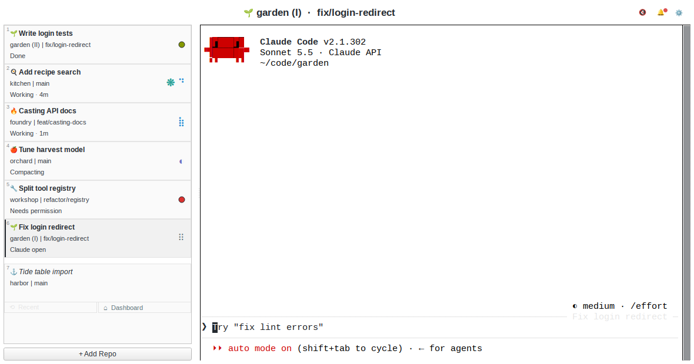
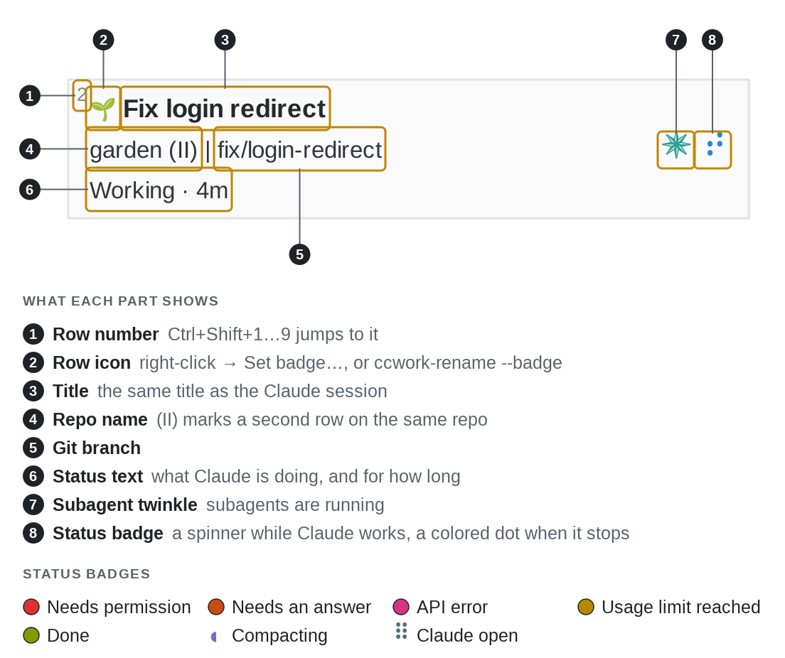
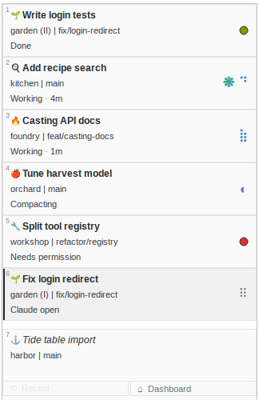
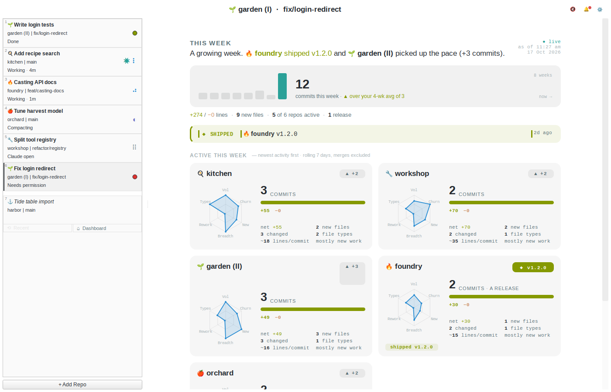

# ccwork

<p align="center">
  <picture>
    <source media="(prefers-color-scheme: dark)" srcset="logo/banner.svg">
    
  </picture>
</p>

<p align="center">
  <a href="https://github.com/kleer001/ccwork/actions/workflows/test.yml"></a>
  <a href="LICENSE"></a>
  
  
</p>

A desktop app for running Claude Code in many repos at once. One window
holds a sidebar of repos and a terminal for each. Claude Code can run a
command, called a hook, when you send a prompt or a reply ends. ccwork
installs hooks that light a status badge on each row, so you can see which
session needs you.

<p align="center">
  
</p>

## What it does

<p align="center">
  
</p>



- **A badge per row.** Red: needs permission. Orange: needs an answer.
  Magenta: API or account error. Yellow: usage limit. Green: done.
- **Three-line rows.** A task title, then `repo | branch`, then Claude's
  state in words: `Working · 2m`, `Compacting`, `Claude open`.
- **A bell for the whole window.** The 🔔 gets a dot when any row gets a
  new badge. 🔊 / 🔇 mutes desktop notifications.
- **One title, two places.** The row title is the Claude session title.
  Rename either side, and the other catches up at your next prompt.
- **Claude can title its own row.** ccwork tells each session about
  `ccwork-rename "<topic>"`; you can run it too.
- **xterm inside.** Each repo runs its own xterm, embedded through X11.
  Ctrl+C reaches the shell; Ctrl+Shift+C and Ctrl+Shift+V copy and paste.
- **Parallel sessions.** Add a repo twice to run two Claude sessions on it.
  Each row shows only its own terminal's state.
- **Rows follow `cd`.** Start `claude` in a different repo from a row's
  terminal, and that row renames itself to the new repo.
- **Weekly review.** A dashboard built from local git: an 8-week commit
  trend and a per-repo chart of churn and rework. No network calls.
- **Shortcuts.** `Ctrl+Shift+O` adds a repo, `Ctrl+Tab` cycles, `F1` lists
  the rest. Keys ccwork doesn't use go to the terminal.

<p align="center">
  
</p>

The [guide](docs/guide.md) has the details and the full Preferences
reference.

## Limits

ccwork runs on Linux only, under X11. On a Wayland desktop it runs through
XWayland, because the embedded terminals need X11. The terminal is always
xterm. A title change crosses between ccwork and Claude only when you send
a prompt or start a session.

## Install

ccwork needs Linux with X11 or XWayland, and `git`, `python3` with `venv`,
`xterm` and `socat`. On Debian or Ubuntu that is
`sudo apt install git python3 python3-venv xterm socat`. Then one line
installs ccwork:

```bash
curl -fsSL https://raw.githubusercontent.com/kleer001/ccwork/main/bootstrap.sh | bash
```

The script clones into `~/ccwork` (set `CCWORK_DEST` to change that), makes
a venv and installs the dependencies, PySide6 (Qt for Python) among them.
`socat` carries hook messages to the app; an `nc` with Unix-socket support
also works. The script then edits two files. It backs up each one to
`~/.local/share/ccwork/backups/` first.

- `~/.bashrc` gets a marked block that puts ccwork's `bin/` on `PATH`.
- `~/.claude/settings.json` gets ccwork's hook entries.

Outside ccwork the hooks exit at once, so `claude` in any other terminal
behaves as before. The script also adds a `.desktop` launcher. Open a new
terminal and run `ccwork`, or start it from your app menu. Re-run the same
line to upgrade.

Flags go after `bash -s --`: `--dry-run` previews every change,
`--uninstall` removes ccwork's entries from both files (backing them up
first), and `--help` lists the rest.

```bash
curl -fsSL https://raw.githubusercontent.com/kleer001/ccwork/main/bootstrap.sh | bash -s -- --dry-run
```

<details>
<summary><b>Manual install, if you'd rather not pipe a script to bash</b></summary>

```bash
git clone https://github.com/kleer001/ccwork ~/ccwork
cd ~/ccwork
python3 -m venv .venv
.venv/bin/pip install -r requirements.txt
./install.sh --dry-run   # preview
./install.sh             # apply
source ~/.bashrc         # pick up PATH change
ccwork                   # launch
```

`install.sh` is the installer the bootstrap runs. It takes `--dry-run` and
`--uninstall`.
[docs/setup.md](docs/setup.md) has the details.

</details>
